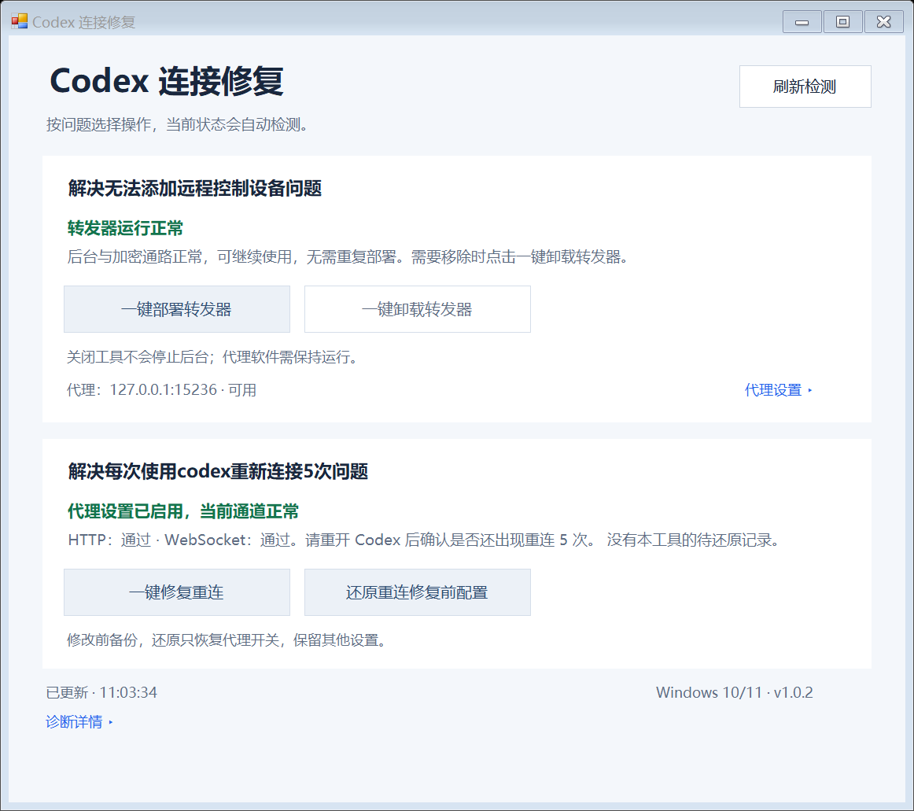

# Codex Connect Fix

**Codex Connect Fix is a Windows GUI built to address two specific problems: being unable to add a remote control device, and Codex repeatedly attempting to reconnect five times whenever you use it.**

- **Cannot add a remote control device:** when a local proxy setup prevents Codex from starting pairing or adding a phone or another computer, deploy a background relay with one click to help restore remote device setup and connectivity.
- **Codex reconnects five times on each use:** when Codex is not using the system proxy correctly, apply the proxy-setting repair with one click and check the current HTTP and WebSocket connection status.

Both fixes share a Chinese interface, with buttons to **uninstall the relay** and **restore the setting from before the reconnect repair**. Unzip a release and double-click `CodexConnectFix.exe`; end users do not need Python, Node.js, or PowerShell commands.

This is an **unofficial community compatibility tool**, unaffiliated with OpenAI. Update the official desktop app first. Read the [official remote connection documentation](https://learn.chatgpt.com/docs/remote-connections) and [changelog](https://learn.chatgpt.com/docs/changelog) for current behavior.

| Section | Actions |
| --- | --- |
| Cannot add a remote control device | Deploy a background relay / uninstall the relay |
| Codex repeatedly reconnects five times | Enable system-proxy support with a private backup / restore the previous flag |

The reconnect action addresses **system proxy configuration**, not every possible cause of repeated reconnects. It uses the desktop CLI's `respect_system_proxy` feature and diagnostic command. It preserves model providers and ChatGPT mode. If the flag is already enabled or unsupported, it explains this instead of applying an unrelated workaround.

## Requirements and use

Windows 10/11, .NET Framework 4.8, the official Codex desktop app, and a running, unauthenticated **local HTTP CONNECT proxy**. SOCKS-only ports, remote proxies, PAC scripts, and proxy authentication are not supported. Open the GUI as the desktop user; relay deployment/removal requests Windows elevation separately. An elevated GUI for the same desktop account is supported, but the desktop CLI always runs without administrator privileges. Running as a different account blocks user-specific configuration changes.

Version 1.0.2 detects the current state automatically and shows it in each section. The compact layout supports real display scaling and scrolls in small windows. Manual proxy settings and diagnostic details are collapsed initially. Expand **代理设置** to enter an HTTP/mixed port such as `7890`, or leave it empty for discovery. Diagnostics distinguish an enabled proxy setting, current HTTP/WebSocket results, and a restorable backup; passing checks do not prove that reconnect symptoms are permanently resolved.

Deployment adds a system hosts entry for `chatgpt.com` at `127.0.0.2`, affecting **all local applications connecting directly to that hostname**. The relay listens only on loopback, tunnels to the fixed `chatgpt.com:443` destination, and forwards TLS unchanged. It installs no certificate and does not decrypt traffic. The proxy must route this destination correctly; a direct rule that resolves back through hosts can cause a loop. Both pre-install and post-hosts connection probes are checked.

The ordinary-user background task starts at sign-in and has a one-minute recovery trigger. Closing the GUI or a terminal does not stop it. Closing the proxy interrupts connections until that proxy returns on the same port. Sleep, sign-out, and shutdown make the computer unavailable remotely.

Uninstall stops/removes this tool's task and hosts block, preserving program files and backups for inspection. Restore changes only the proxy flag, preserving other configuration; an originally implicit false value may become explicit. A config file already deleted by the user is not recreated. Pairing is still performed in the official Codex app.

Only one user deploys a relay per machine. Both supported task identities, `CodexRemoteProxyFix` and `CodexRemoteRelayHelper`, use the same health display and uninstall button. A healthy relay does not need replacement. The tool verifies the task identity and saves backups before removing its task and hosts mapping; program files are retained. Backups for `CodexRemoteProxyFix` removal are saved under `%ProgramData%\CodexConnectionHelper-UninstallBackups\`. Unknown hosts mappings, modified markers, conflicting tasks, and unsafe backup directories are refused. The GUI restore button is labeled “还原重连修复前配置”; it restores only the proxy flag, preserving other settings and later edits.

## Data and privacy

- Program: `%ProgramFiles%\CodexRemoteRelayHelper\`
- Relay config, hosts/task backups and bounded log: `%ProgramData%\CodexRemoteRelayHelper\`
- Private reconnect backups: `%LOCALAPPDATA%\CodexConnectionHelper\reconnect-backups\`
- Task: `CodexRemoteRelayHelper`

Backups can contain private TOML settings. They remain local with a restricted ACL; do not attach them to issues. Diagnostics invoke the official CLI, which can use its normal authentication and network behavior. The GUI displays only four selected status values, not raw account or token details. The tool has no telemetry service. Unsigned community builds may be shown as an unknown publisher by Windows.

## Build and development

Run `./build.ps1` in Windows PowerShell or PowerShell 7. The script uses the built-in .NET Framework compiler and runs offline tests. `./package.ps1` rebuilds and creates allowlisted release/source ZIPs and SHA-256 checksums under `dist`. No package download is needed.

The Windows CI workflow builds the application and runs the tests. See the [contributing guide](CONTRIBUTING.md), [verification limits](docs/verification.md), and the more detailed [Chinese README](README.md).

MIT license. Contributions and reports are welcome; exclude credentials and raw user configuration.
